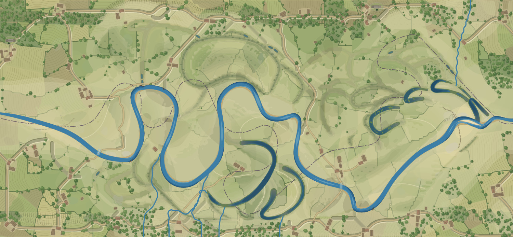

# Meander



Meander is a live browser simulation of a meandering river. Over centuries the channel migrates across its floodplain and cuts off its own loops into *oxbow lakes*, while farms and woodland grow up around it. The model is written in Rust and compiled to WebAssembly, and the page draws it as SVG.

## Running with Nix

Build the site and serve it with any static file server:

```console
$ nix build
$ nix run nixpkgs#python3 -- -m http.server -d result 8000
```

Then open http://localhost:8000. `nix build` puts the page, its scripts and the compiled WASM in `result/`.

For development, the dev shell supplies the Rust toolchain, `wasm-pack` and the test tools:

```console
$ nix develop   # or `direnv allow` once
$ make serve    # build, then serve web/ at http://localhost:8000
$ make test     # run the model's validation tests
$ make tui      # run the river in the terminal
```
